# NestOwl AI 知识库 · 领域模型

| 项目 | 内容 |
| --- | --- |
| 文档版本 | v0.1 |
| 更新日期 | 2026-10-20 |
| 关联文档 | [PRD](../prd/ai-knowledge-base.md) · [模块骨架](./module-skeleton.md) |

---

## 1. 设计原则

1. **模块化单体优先**：先在一个 NestJS 应用内划清限界上下文，等入库/检索成为瓶颈后再拆服务。
2. **租户隔离是一等公民**：所有业务表带 `workspace_id`，仓储层强制注入，禁止跨租户查询。
3. **版本不可变，指针可变**：文档内容、分块、向量一旦生成即不可变；通过切换 `current_version_id` 完成更新，保证引用可回溯。
4. **权限进入查询条件**：ACL 不是展示层过滤，而是召回 SQL 的一部分。
5. **事件驱动副作用**：ACL 扇出、缺口聚类、评测、分析通过领域事件解耦，关键事件走 Outbox。
6. **软删除 + 保留快照**：文档删除后引用仍可展示；审计与引用快照不受级联删除影响。
7. **ID 使用 ULID**：可按时间排序，便于分页与分片；对外不暴露自增 ID。

---

## 2. 限界上下文

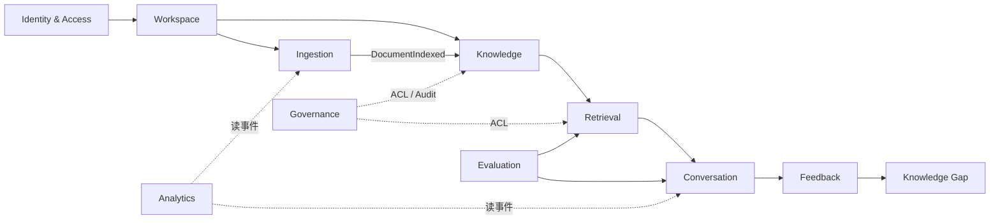

| 上下文 | 职责 | 拥有的数据 |
| --- | --- | --- |
| Identity & Access | 用户、登录、API Key、SSO | users, api_keys, sessions |
| Workspace | 租户、成员、角色、配额 | workspaces, memberships, invites, quotas |
| Knowledge | 知识库、目录、文档、版本、分块、元数据、标签 | knowledge_bases, folders, documents, document_versions, chunks, metadata_schemas, tags |
| Ingestion | 数据源、连接器、同步、解析、分块、向量化、索引 | data_sources, sync_runs, ingestion_jobs, parse_artifacts |
| Retrieval | 查询理解、混合召回、重排、上下文构建、检索轨迹 | retrieval_traces, retrieval_configs |
| Conversation | 会话、消息、引用、流式输出 | conversations, messages, citations |
| Feedback | 反馈、知识缺口 | feedback, knowledge_gaps |
| Governance | 资源 ACL、审计、保留策略、敏感级别 | resource_acls, document_acls, audit_logs, retention_policies |
| Evaluation | 评测集、用例、评测运行、指标 | eval_datasets, eval_cases, eval_runs, eval_results |
| Analytics | 只读投影、看板、埋点 | analytics_events, daily_metrics |

**依赖规则**

- 上层（interface）→ 应用层（application）→ 领域层（domain）。
- 领域层不依赖 NestJS、ORM、HTTP。
- 跨上下文只通过应用服务接口或领域事件交互，禁止直接访问对方的 Repository。
- `Retrieval` 通过 `ChunkReadPort` 读取 `Knowledge` 的分块读模型；`Ingestion` 通过 `DocumentWritePort` 写入。
- `Analytics` 只读，不反向写业务表。

---

## 3. 聚合与实体

### 3.1 Workspace 上下文

**聚合根：Workspace**

| 字段 | 类型 | 说明 |
| --- | --- | --- |
| id | ULID | 工作区 ID |
| name | string | 名称 |
| slug | string | 唯一短链 |
| plan | enum | free / team / enterprise |
| status | enum | active / suspended / deleted |
| settings | jsonb | 默认模型、保留策略、安全策略 |
| created_at | timestamptz | |

**实体：Membership**（workspace_id, user_id, role, status, joined_at）

**值对象：Role**（owner / admin / editor / contributor / reader）

**不变量**

- 一个工作区至少一个 owner。
- 成员角色变更立即影响权限判定。
- 配额超限时禁止新增文档/提问，但允许读取与删除。

### 3.2 Knowledge 上下文

**聚合根：KnowledgeBase**

| 字段 | 类型 | 说明 |
| --- | --- | --- |
| id | ULID | |
| workspace_id | ULID | 租户 |
| name | string | 工作区内唯一 |
| description | text | |
| visibility | enum | private / team / org |
| status | enum | active / archived |
| embedding_profile_id | ULID? | 绑定向量模型 |
| retrieval_config | jsonb | TopK、阈值、RRF 权重、上下文预算 |
| document_count | int | 冗余计数，异步更新 |
| created_by | ULID | |
| created_at / updated_at | timestamptz | |

**聚合根：Document**

| 字段 | 类型 | 说明 |
| --- | --- | --- |
| id | ULID | 文档身份，跨版本不变 |
| workspace_id / kb_id / folder_id | ULID | |
| title | string | |
| source_type | enum | upload / url / connector / manual |
| source_uri | text? | 原始地址 |
| mime_type / size_bytes / checksum | | 去重与展示 |
| lifecycle_status | enum | draft / published / archived / expired |
| index_status | enum | not_indexed / queued / processing / ready / failed / stale |
| current_version_id | ULID? | 当前可检索版本 |
| owner_id | ULID | 必须有 Owner |
| sensitivity | enum | public / internal / confidential / restricted |
| metadata | jsonb | 按 Schema 校验 |
| acl_version | int | ACL 物化版本，用于并发检测 |
| valid_from / valid_until | timestamptz? | 有效期 |
| deleted_at | timestamptz? | 软删除 |
| created_at / updated_at | timestamptz | |

**实体：DocumentVersion**（不可变）

| 字段 | 类型 | 说明 |
| --- | --- | --- |
| id | ULID | |
| document_id | ULID | |
| version_no | int | 从 1 递增 |
| content_hash | string | 规范化内容哈希 |
| raw_object_key | string | 对象存储 Key |
| extracted_text | text? | 解析后的纯文本（可选独立存储） |
| parser_version / chunker_version | string | 处理链版本 |
| embedding_model / embedding_dim | string / int | 向量模型快照 |
| status | enum | pending / processing / ready / failed |
| error | jsonb? | stage、code、message |
| created_by / created_at | | |

**实体：Chunk**

| 字段 | 类型 | 说明 |
| --- | --- | --- |
| id | ULID | |
| document_id / version_id | ULID | |
| parent_chunk_id | ULID? | 父子块 |
| ordinal | int | 版本内顺序 |
| content | text | |
| token_count | int | |
| heading_path | text[] | 标题路径 |
| page_from / page_to | int? | PDF 页码 |
| start_offset / end_offset | int? | 原文偏移 |
| embedding | vector(1024)? | 维度由模型决定 |
| content_tsv | tsvector | 关键词检索 |
| metadata | jsonb | 继承文档元数据 |
| created_at | timestamptz | |

**聚合根：MetadataSchema**（kb_id, fields jsonb, version, status）

**实体：Tag / GlossaryTerm**（term, synonyms[], definition）

**不变量**

- `Document.current_version_id` 必须属于该文档，且 `status = ready`。
- 只有 `published` 且 `index_status = ready` 且在有效期内的文档可被检索。
- `Chunk.version_id` 必须等于其所属文档的某个历史版本。
- 文档标题、ACL、Owner 变更不产生新版本；内容、分块策略、Embedding 模型变更必须产生新版本。
- 同一知识库内 `checksum` 相同的文档默认复用已有版本，不重复向量化。

### 3.3 Ingestion 上下文

**聚合根：DataSource**（workspace_id, kb_id, type, config_encrypted, credential_ref, sync_mode, schedule, cursor, status）

**实体：SyncRun**（source_id, status, stats jsonb, started_at, finished_at, error）

**聚合根：IngestionJob**（document_id, version_id, stage, status, attempts, idempotency_key, error, timings）

**值对象：IngestionStage**（fetch / parse / normalize / chunk / embed / index / activate）

**不变量**

- 同一 `(document_id, version_id, stage)` 同时最多一个 running 任务。
- `idempotency_key = hash(version_id + stage + attempt_group)`。
- 重试不改变已成功阶段的产物。
- 连接器删除同步时只软删除文档，不物理删除历史版本。

### 3.4 Retrieval 上下文

**聚合根：RetrievalTrace**（append-only）

| 字段 | 类型 | 说明 |
| --- | --- | --- |
| id | ULID | |
| workspace_id / message_id | ULID | |
| query_original / query_rewritten | text | |
| filters | jsonb | kb_ids、元数据、时间、权限主体 |
| candidates | jsonb | [{chunk_id, source, score, rank}] |
| rerank_scores | jsonb | |
| timings | jsonb | rewrite/recall/rerank/context ms |
| config_snapshot | jsonb | 检索配置版本 |
| created_at | timestamptz | |

**值对象：RetrievalConfig**（top_k, score_threshold, hybrid_alpha, rerank_enabled, context_budget, model）

**不变量**

- Trace 只追加，不更新。
- 候选必须记录来源（vector / keyword / title / rerank）。
- 写入 Trace 的 `chunk_id` 必须来自本次权限过滤后的候选集。
- Trace 默认保留 30 天，之后聚合为统计指标。

### 3.5 Conversation 上下文

**聚合根：Conversation**（workspace_id, user_id, title, kb_ids[], mode, created_at, updated_at）

**实体：Message**

| 字段 | 类型 | 说明 |
| --- | --- | --- |
| id | ULID | |
| conversation_id | ULID | |
| role | enum | user / assistant / system |
| content | text | |
| status | enum | pending / streaming / completed / failed / canceled |
| model | string? | |
| token_usage | jsonb? | prompt / completion / total |
| latency_ms | int? | |
| trace_id | string? | |
| created_at | timestamptz | |

**实体：Citation**

| 字段 | 类型 | 说明 |
| --- | --- | --- |
| id | ULID | |
| message_id | ULID | |
| chunk_id | ULID? | 分块删除后置空 |
| document_id / version_id | ULID | |
| document_title | string | 快照 |
| quote | text | 快照，≤ 500 字 |
| page_from / page_to | int? | 快照 |
| url | text? | 原文链接 + 锚点 |
| rank / score | int / numeric | |
| created_at | timestamptz | |

**不变量**

- 一条 assistant 消息的引用必须来自该消息对应的 RetrievalTrace 候选集。
- Citation 保存展示所需快照，文档删除后仍可渲染。
- 用户消息不可编辑；重新生成创建新的 assistant 消息。
- 会话删除为软删除，审计与反馈保留。

### 3.6 Feedback 上下文

**聚合根：Feedback**（message_id, user_id, rating, reason_code, comment, corrected_answer, status, created_at）

**聚合根：KnowledgeGap**（workspace_id, kb_id, title, cluster_key, sample_queries jsonb, occurrences, status, assignee_id, first_seen_at, last_seen_at）

**不变量**

- 同一用户对同一消息只保留一条有效反馈（upsert）。
- 缺口由系统生成，人工只能修改状态、负责人和备注。
- 缺口关闭必须关联至少一个已发布文档。

### 3.7 Governance 上下文

**聚合根：ResourceAcl**（resource_type, resource_id, principal_type, principal_id, permission）

**投影：DocumentAcl**（document_id, principal_key, source）——只读物化表，供检索过滤。

**实体：AuditLog**（append-only；actor, action, resource, ip, user_agent, metadata, created_at）

**不变量**

- `principal_key` 格式：`user:<id>`、`group:<id>`、`workspace:<id>`、`role:<name>`。
- 文档的读取授权 = 知识库可见性 ∪ 目录继承 ∪ 文档显式授权。
- ACL 变更后必须在 5 秒内完成 `document_acl` 扇出；扇出期间使用旧版本，保证不泄露。
- 审计日志禁止 UPDATE/DELETE；按月分区。

### 3.8 Evaluation 上下文

**聚合根：EvalDataset**（workspace_id, kb_id, name, description）

**实体：EvalCase**（question, expected_answer, gold_chunk_ids[], tags[], difficulty）

**聚合根：EvalRun**（dataset_id, config_snapshot, status, metrics jsonb, started_at, finished_at）

**实体：EvalResult**（case_id, retrieved_ids, answer, scores jsonb, latency_ms, cost_micro_usd）

**不变量**

- EvalRun 必须保存完整配置快照（模型、Prompt 版本、检索参数），保证可复现。
- 评测结果不可修改；重跑生成新 Run。

---

## 4. 实体关系图

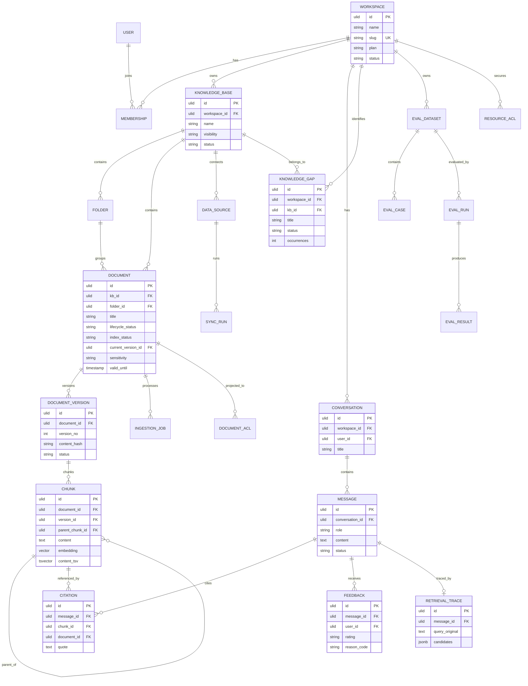

---

## 5. 状态机

### 5.1 文档生命周期

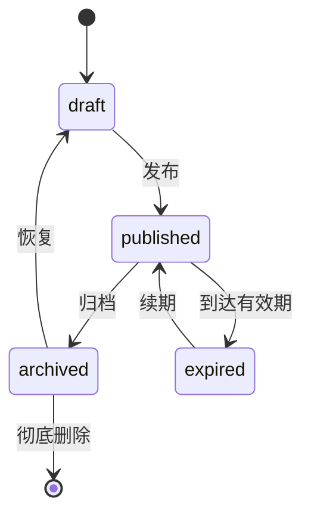

### 5.2 索引状态

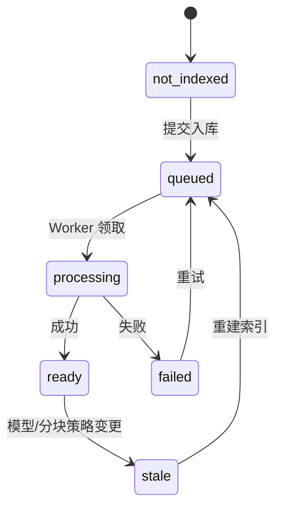

### 5.3 入库任务

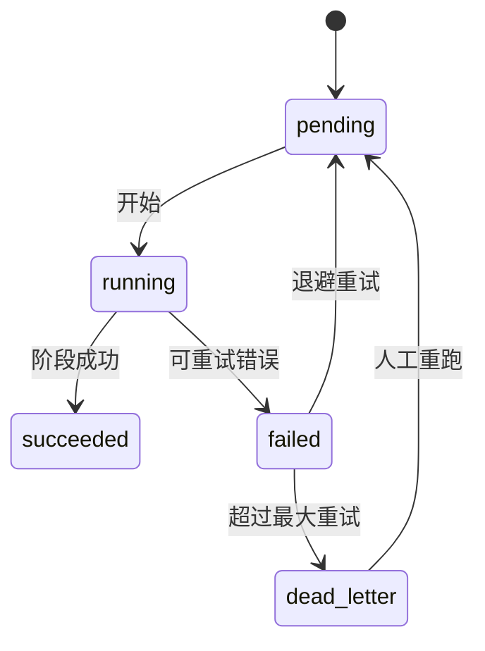

### 5.4 同步任务

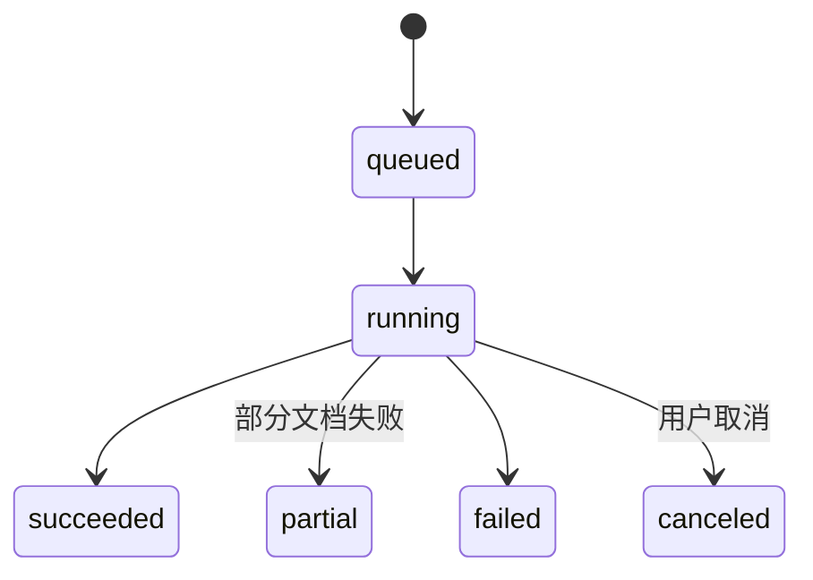

### 5.5 消息

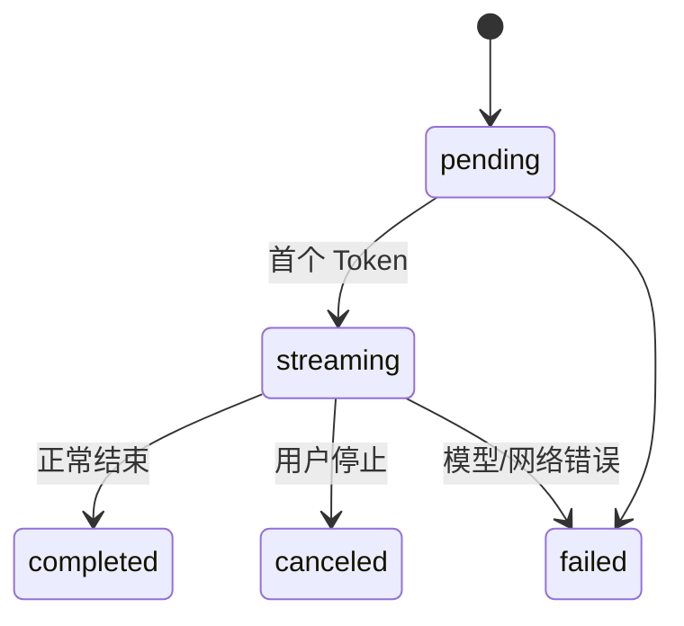

### 5.6 知识缺口

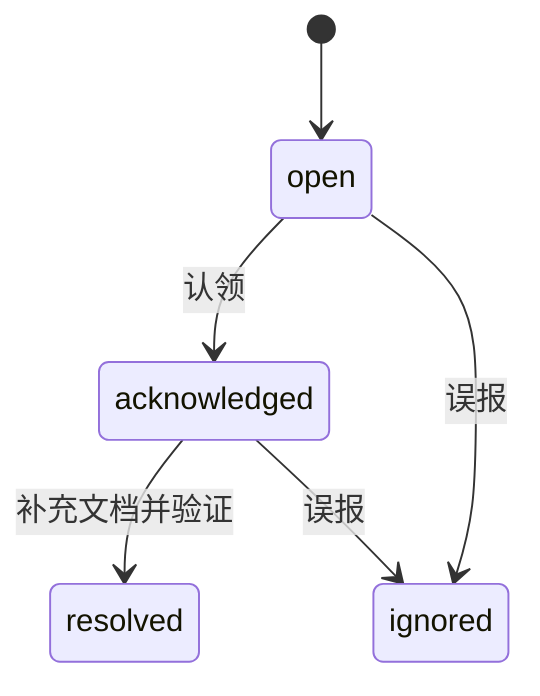

---

## 6. 权限模型

### 6.1 授权来源

```
工作区 Owner/Admin  → 全部资源 manage
知识库 visibility=org → workspace:<id> 读取
知识库 visibility=team → group:<id> 读取
知识库/目录/文档显式授权 → user:<id> / group:<id> / role:<name>
敏感级别 clearance  → 二次过滤
```

### 6.2 物化读取权限

检索不实时递归目录树，而是维护只读投影 `document_acl`：

| 字段 | 说明 |
| --- | --- |
| document_id | 文档 |
| principal_key | `user:<id>` / `group:<id>` / `workspace:<id>` / `role:<name>` |
| source | `kb_visibility` / `folder_inherit` / `document_grant` / `admin` |
| acl_version | 文档 ACL 版本 |

**扇出流程**

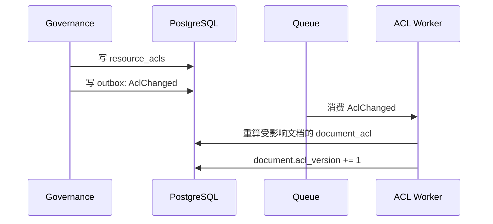

### 6.3 检索过滤 SQL（示意）

```sql
select c.id, c.content
from chunks c
join documents d on d.id = c.document_id
where d.workspace_id = $1
  and d.lifecycle_status = 'published'
  and d.index_status = 'ready'
  and d.deleted_at is null
  and (d.valid_until is null or d.valid_until > now())
  and d.current_version_id = c.version_id
  and exists (
    select 1
    from document_acl da
    where da.document_id = d.id
      and da.principal_key = any($2::text[])
  );
```

`$2` 形如 `['user:u_1', 'group:g_3', 'workspace:w_1', 'role:editor']`。

**不变量**

- 检索 SQL 必须同时包含 `workspace_id`、生命周期、ACL 三个条件，缺一不可。
- 权限变更与检索并发时，宁可返回旧权限结果，也不能返回越权内容；`acl_version` 用于检测并重试。
- 引用展示前再次校验当前用户对文档的读取权限；无权限时展示「来源已不可访问」，不展示原文。

---

## 7. 关键流程

### 7.1 文档入库

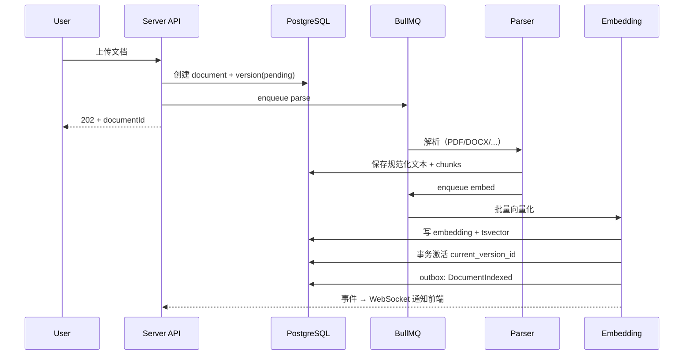

**激活事务**

1. 校验版本状态为 `ready`。
2. 更新 `documents.current_version_id`、`index_status = ready`。
3. 写 `outbox_events(DocumentIndexed)`。
4. 提交后异步清理旧版本分块（保留被引用版本）。

### 7.2 检索与回答

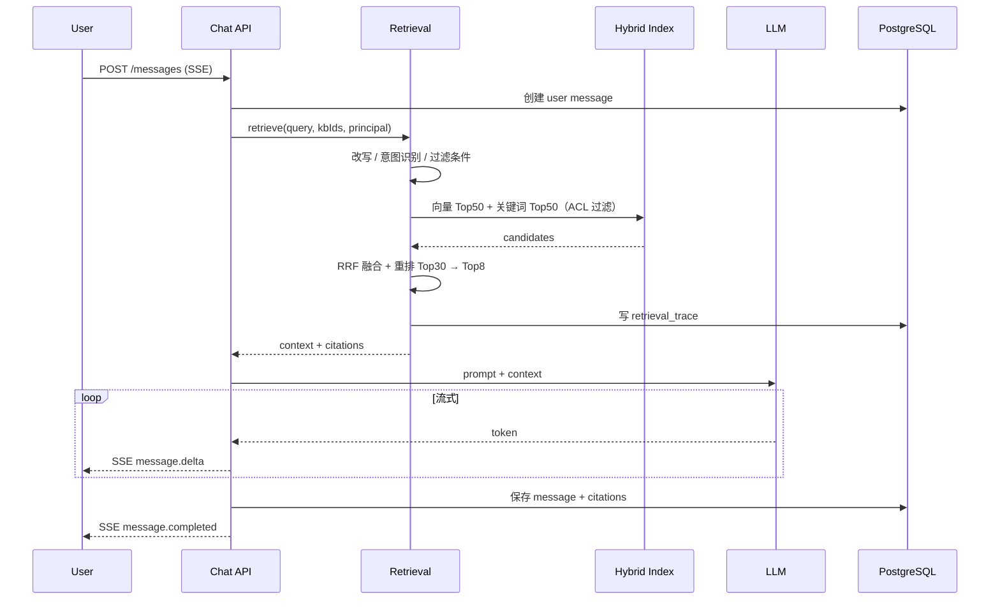

### 7.3 反馈到知识缺口

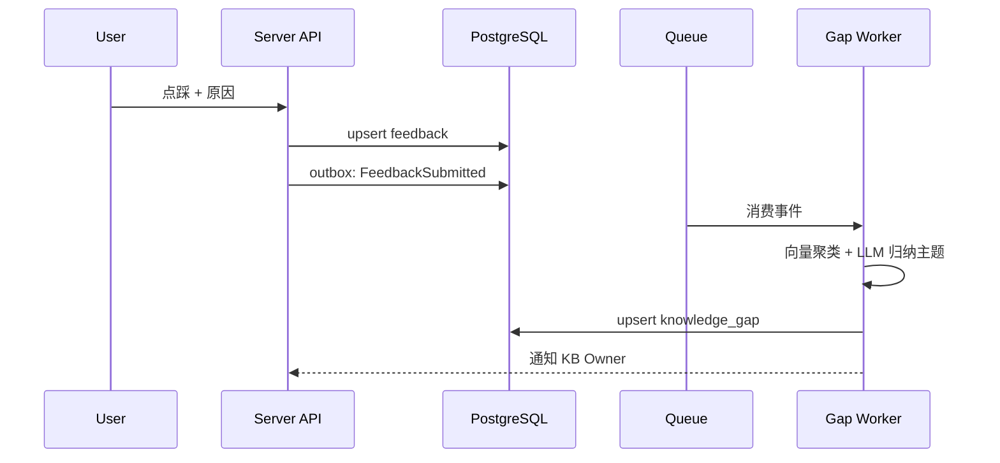

---

## 8. 核心表 DDL（节选）

> 完整迁移脚本在实现阶段放入 `apps/server/src/platform/database/migrations`。以下为设计基线。

```sql
create extension if not exists vector;
create extension if not exists pg_trgm;

create type document_lifecycle as enum ('draft', 'published', 'archived', 'expired');
create type document_index_status as enum ('not_indexed', 'queued', 'processing', 'ready', 'failed', 'stale');
create type resource_type as enum ('kb', 'folder', 'document');
create type principal_type as enum ('user', 'group', 'workspace', 'role');
create type acl_permission as enum ('read', 'write', 'manage');

create table knowledge_bases (
  id            char(26) primary key,
  workspace_id  char(26) not null references workspaces(id),
  name          varchar(80) not null,
  description   text not null default '',
  visibility    varchar(16) not null default 'private',
  status        varchar(16) not null default 'active',
  embedding_profile_id char(26),
  retrieval_config jsonb not null default '{}'::jsonb,
  document_count integer not null default 0,
  created_by    char(26) not null,
  created_at    timestamptz not null default now(),
  updated_at    timestamptz not null default now(),
  unique (workspace_id, name)
);

create table documents (
  id                 char(26) primary key,
  workspace_id       char(26) not null references workspaces(id),
  kb_id              char(26) not null references knowledge_bases(id),
  folder_id          char(26) references folders(id),
  title              varchar(300) not null,
  source_type        varchar(16) not null,
  source_uri         text,
  mime_type          varchar(120),
  size_bytes         bigint,
  checksum           char(64),
  lifecycle_status   document_lifecycle not null default 'draft',
  index_status       document_index_status not null default 'not_indexed',
  current_version_id char(26),
  owner_id           char(26) not null,
  sensitivity        varchar(16) not null default 'internal',
  metadata           jsonb not null default '{}'::jsonb,
  acl_version        integer not null default 0,
  valid_from         timestamptz,
  valid_until        timestamptz,
  deleted_at         timestamptz,
  created_at         timestamptz not null default now(),
  updated_at         timestamptz not null default now()
);

create index documents_kb_idx on documents (kb_id, lifecycle_status, index_status);
create index documents_owner_idx on documents (owner_id);
create index documents_metadata_idx on documents using gin (metadata jsonb_path_ops);
create unique index documents_checksum_uk on documents (kb_id, checksum)
  where deleted_at is null and checksum is not null;

create table document_versions (
  id                char(26) primary key,
  document_id       char(26) not null references documents(id),
  version_no        integer not null,
  content_hash      char(64) not null,
  raw_object_key    text,
  parser_version    varchar(32) not null,
  chunker_version   varchar(32) not null,
  embedding_model   varchar(80) not null,
  embedding_dim     integer not null,
  status            varchar(16) not null default 'pending',
  error             jsonb,
  created_by        char(26) not null,
  created_at        timestamptz not null default now(),
  unique (document_id, version_no)
);

create table chunks (
  id             char(26) primary key,
  workspace_id   char(26) not null,
  document_id    char(26) not null references documents(id),
  version_id     char(26) not null references document_versions(id),
  parent_chunk_id char(26) references chunks(id),
  ordinal        integer not null,
  content        text not null,
  token_count    integer not null,
  heading_path   text[] not null default '{}',
  page_from      integer,
  page_to        integer,
  start_offset   integer,
  end_offset     integer,
  metadata       jsonb not null default '{}'::jsonb,
  embedding      vector(1024),
  content_tsv    tsvector generated always as (to_tsvector('simple', content)) stored,
  created_at     timestamptz not null default now()
);

create index chunks_version_idx on chunks (version_id, ordinal);
create index chunks_tsv_idx on chunks using gin (content_tsv);
create index chunks_embedding_idx on chunks using hnsw (embedding vector_cosine_ops)
  with (m = 16, ef_construction = 64);
create index chunks_metadata_idx on chunks using gin (metadata jsonb_path_ops);

create table resource_acls (
  id            char(26) primary key,
  workspace_id  char(26) not null,
  resource_type resource_type not null,
  resource_id   char(26) not null,
  principal_type principal_type not null,
  principal_id  varchar(80) not null,
  permission    acl_permission not null,
  created_by    char(26) not null,
  created_at    timestamptz not null default now(),
  unique (resource_type, resource_id, principal_type, principal_id, permission)
);

create table document_acl (
  document_id   char(26) not null references documents(id) on delete cascade,
  workspace_id  char(26) not null,
  principal_key varchar(80) not null,
  source        varchar(24) not null,
  acl_version   integer not null,
  primary key (document_id, principal_key)
);

create index document_acl_principal_idx on document_acl (workspace_id, principal_key);

create table retrieval_traces (
  id             char(26) primary key,
  workspace_id   char(26) not null,
  message_id     char(26) not null,
  query_original text not null,
  query_rewritten text,
  filters        jsonb not null default '{}'::jsonb,
  candidates     jsonb not null default '[]'::jsonb,
  rerank_scores  jsonb not null default '[]'::jsonb,
  timings        jsonb not null default '{}'::jsonb,
  config_snapshot jsonb not null default '{}'::jsonb,
  created_at     timestamptz not null default now()
);

create index retrieval_traces_message_idx on retrieval_traces (message_id);
create index retrieval_traces_created_idx on retrieval_traces (workspace_id, created_at);

create table citations (
  id             char(26) primary key,
  message_id     char(26) not null references messages(id) on delete cascade,
  chunk_id       char(26) references chunks(id) on delete set null,
  document_id    char(26) not null,
  version_id     char(26) not null,
  document_title varchar(300) not null,
  quote          text not null,
  page_from      integer,
  page_to        integer,
  url            text,
  rank           integer not null,
  score          numeric(6,4),
  created_at     timestamptz not null default now()
);

create index citations_message_idx on citations (message_id, rank);
```

**说明**

- 中文全文检索需安装 `zhparser` 或 `pg_jieba`，否则 `to_tsvector('simple', ...)` 对中文分词效果有限；MVP 可用 `pg_trgm` 兜底。
- `vector(1024)` 需与 Embedding 模型维度一致，切换模型必须重建索引。
- `document_acl` 只存读取权限；写/管理权限实时查 `resource_acls`。
- 大表按 `workspace_id` 做逻辑分片预留；审计表按月分区。

---

## 9. 领域事件

| 事件 | 生产者 | 消费者 | 关键载荷 |
| --- | --- | --- | --- |
| `DocumentVersionCreated` | Ingestion | Ingestion | document_id, version_id |
| `DocumentIndexed` | Ingestion | Knowledge, Analytics | document_id, version_id, chunk_count |
| `DocumentIndexFailed` | Ingestion | Knowledge, Analytics | document_id, stage, error_code |
| `DocumentPublished` | Knowledge | Retrieval, Analytics | document_id |
| `DocumentArchived` | Knowledge | Retrieval | document_id |
| `AclChanged` | Governance | Governance(worker), Retrieval | resource_type, resource_id |
| `ConversationMessageCompleted` | Conversation | Analytics, Feedback | message_id, tokens, citations |
| `AnswerAbstained` | Conversation | Analytics, Gap | message_id, reason, top_score |
| `FeedbackSubmitted` | Feedback | Gap, Analytics | message_id, rating, reason |
| `KnowledgeGapOpened` | Feedback | Notification, Analytics | gap_id, kb_id |
| `EvalRunCompleted` | Evaluation | Analytics, Notification | run_id, metrics |

**事件信封**

```json
{
  "event_id": "01J...",
  "type": "DocumentIndexed",
  "version": 1,
  "occurred_at": "2026-10-20T09:00:00Z",
  "workspace_id": "01J...",
  "aggregate_id": "01J...",
  "trace_id": "...",
  "payload": {}
}
```

---

## 10. 一致性与事务边界

| 场景 | 一致性要求 | 方案 |
| --- | --- | --- |
| 版本激活 | 强一致 | 单事务更新 document 指针 + 写 outbox |
| ACL 变更 | 最终一致（≤5s） | outbox + 扇出 worker；旧 ACL 继续服务 |
| 文档删除 | 强一致（不可检索） | 事务软删除 + 立即从读模型排除 |
| 引用落库 | 强一致 | 与消息完成同一事务 |
| 缺口聚类 | 最终一致 | 异步任务，允许分钟级延迟 |
| 分析看板 | 最终一致 | 事件投影，分钟级延迟 |

**Outbox 表**

```sql
create table outbox_events (
  id           char(26) primary key,
  workspace_id char(26) not null,
  type         varchar(80) not null,
  payload      jsonb not null,
  status       varchar(16) not null default 'pending',
  attempts     integer not null default 0,
  available_at timestamptz not null default now(),
  created_at   timestamptz not null default now()
);
```

---

## 11. 数据生命周期

| 数据 | 保留策略 |
| --- | --- |
| 文档（软删除） | 回收站 30 天，之后物理删除 |
| 文档版本 | 保留最近 5 个；被引用的版本永久保留（或随消息删除） |
| 分块 | 随版本；旧版本清理时排除被引用分块 |
| 会话与消息 | 默认 2 年，可按工作区配置 |
| 检索轨迹 | 30 天，之后聚合 |
| 反馈 | 2 年 |
| 审计日志 | 1 年（企业版可配 3 年） |
| 原始文件 | 文档删除后 30 天清理 |
| 评测集 | 永久，除非手动删除 |

---

## 12. 命名与约定

- 表名：复数 snake_case；字段 snake_case；枚举值 snake_case。
- 主键：`char(26)` ULID；外键同名 `_id`。
- 时间：`timestamptz`，统一 UTC。
- 金额：`bigint` 存微美元（micro-USD），避免浮点。
- 软删除：`deleted_at`，查询默认过滤。
- JSONB 字段必须有 Schema 版本或应用层校验。
- 所有写操作记录 `created_by` / `updated_by`（能追溯到人）。
- 所有跨租户查询由仓储基类强制注入 `workspace_id`，Code Review 必查。
